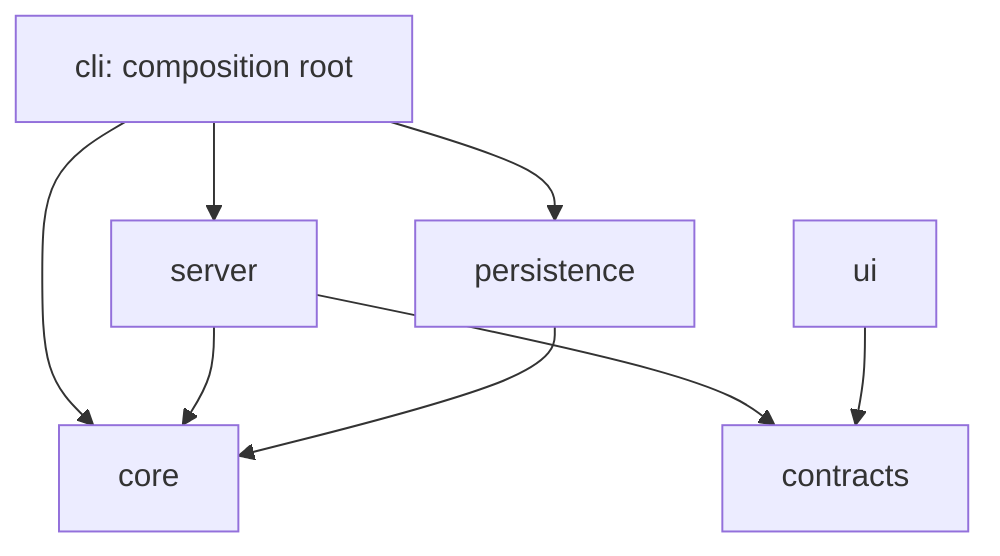
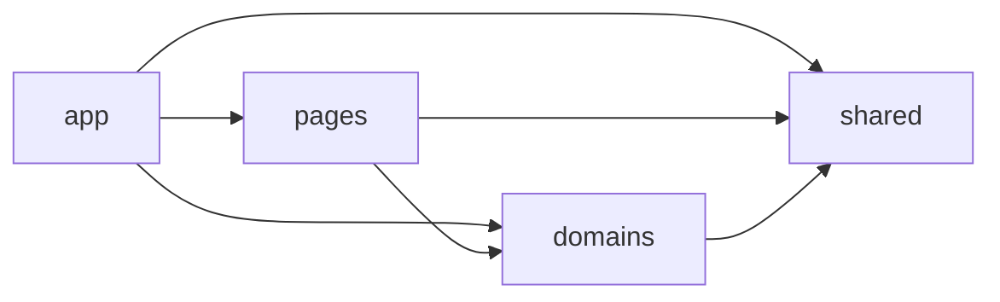

# Node.js And React Full-Stack Architecture

Use this rule for a single-package TypeScript application that combines a Node.js CLI/server with a React UI. It defines strict ownership boundaries while keeping the domain core independent from Node.js and browser frameworks.

## Top-level structure

`src/` has exactly six top-level directories:

| Directory | Ownership |
|-----------|-----------|
| `src/cli/` | Executable entry point, arguments, interactive prompts, lifecycle, composition root |
| `src/core/` | Environment-neutral domain model, validation, business rules, and application services |
| `src/contracts/` | Environment-neutral HTTP API request and response contracts |
| `src/persistence/` | Persistence adapters and platform-specific storage concerns |
| `src/server/` | HTTP listeners, API adapters, static assets, streaming, and protocol handling |
| `src/ui/` | React UI compiled to static assets |

Do not create root-level `src/components/`, `src/utils/`, `src/hooks/`, `src/types/`, or `src/shared/`. Put code under the boundary that owns it.

## Full-stack dependency rule

- `core` and `contracts` import no other project-internal top-level boundary.
- `persistence` imports only `core`.
- `server` imports `core` and `contracts`, not concrete CLI or UI modules.
- `ui` imports `contracts`, never server, persistence, CLI, or Node-only code.
- `cli` is the composition root and may wire server, persistence, and core implementations together.
- Application code depends on persistence interfaces owned by `core`; the CLI injects concrete adapters.
- Map between HTTP contracts and domain values at the server boundary. Do not make domain code depend on wire DTOs.

Circular imports and imports that bypass these boundaries are not allowed.

## Full-stack placement

| What is being created | Location |
|-----------------------|----------|
| CLI command and startup orchestration | `src/cli/` |
| Domain entity, invariant, validation, or application service | `src/core/` |
| In-memory application state and ports for external adapters | `src/core/` |
| API DTO or shared wire-level discriminator | `src/contracts/` |
| Filesystem or other persistence implementation | `src/persistence/` |
| HTTP listener and request dispatch | `src/server/` |
| API handler and DTO mapping | `src/server/` |
| Streaming or upgraded protocol handling | `src/server/` |
| Production static-asset serving | `src/server/` |
| React UI code | `src/ui/` |

Keep Node.js types and APIs out of `core`, `contracts`, and `ui`. Keep browser APIs and React out of every boundary except `ui`.

## React UI structure

`src/ui/` has exactly four directories:

- `app/` — bootstrap, providers, top-level navigation, and page composition.
- `pages/` — thin route-level screens.
- `domains/` — product capabilities and their UI behavior.
- `shared/` — UI primitives and browser helpers with no domain knowledge.

The UI dependency direction is:

A UI domain never imports another UI domain or a page. Cross-domain flows move upward through page composition or app-level orchestration. `src/ui/shared/` must contain no product-domain knowledge.

Do not create `src/ui/components/`, `src/ui/utils/`, `src/ui/hooks/`, or `src/ui/types/` alongside the four required UI directories.

## React placement

| What is being created | Location |
|-----------------------|----------|
| Domain component | `src/ui/domains/<domain>/components/` |
| Component reused by multiple domains without domain knowledge | `src/ui/shared/ui/` |
| Domain hook or mutation orchestration | `src/ui/domains/<domain>/hooks/` |
| Generic browser hook | `src/ui/shared/hooks/` |
| Domain-specific pure UI function | `src/ui/domains/<domain>/utils/` |
| Generic browser utility | `src/ui/shared/utils/` |
| Domain UI types | `src/ui/domains/<domain>/types/` |
| Route-level screen | `src/ui/pages/<route-name>/` |
| API calls for a domain | `src/ui/domains/<domain>/api/` |

Pages remain thin composers. Put business behavior in `core` and domain-specific UI orchestration in a domain hook or component.

## Components and exports

- Use `PascalCase.tsx` for components and component folders.
- Use `camelCase.ts` for hooks, utilities, API modules, and stores.
- Use `kebab-case` for route and feature folders.
- Use named exports by default. Default exports are allowed only where a selected routing or lazy-loading mechanism requires them.
- Complex components may use a folder with co-located styles, tests, and private helpers.
- A component folder's `index.ts` may expose its intentional public API. Do not create broad domain or project barrel files.
- Create shared abstractions only after at least two real consumers demonstrate the common shape.

## Tests and generated output

- Co-locate focused unit and component tests with their source when that improves discoverability.
- Put cross-boundary server tests under `tests/integration/` and browser flows under `tests/e2e/`.
- Test helpers belong under `tests/support/`, not production `src/`.
- Compiled server and UI assets belong under ignored build-output directories, never under `src/`.

## Changing a boundary

Do not bypass this rule for convenience. If a real dependency or packaging constraint makes the layout unsuitable, document the constraint and update this rule and the project's architecture documentation before spreading an exception.
