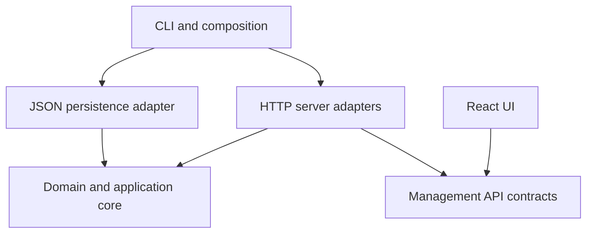
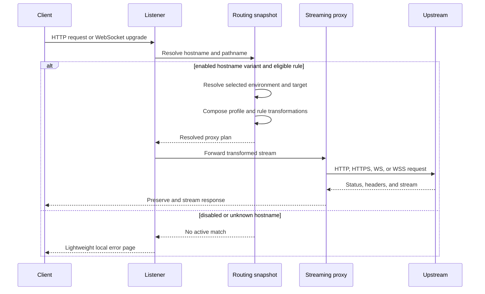

# Architecture

## System Shape

Defftra Router runs as one Node.js process. The same loopback HTTP listener dispatches the reserved management hostname to the API/static UI and configured application hostname variants to the streaming proxy.

```mermaid
flowchart LR
    Browser["Browser or WebSocket client"] --> Listener["Loopback HTTP listener"]
    Listener -->|"router.localhost"| Management["Management API and static UI"]
    Listener -->|"application variant"| Snapshot["Immutable routing snapshot"]
    Snapshot --> Rule["Exact, longest-prefix, or default rule"]
    Rule --> Environment["Selected target environment"]
    Environment --> Transform["Variant profiles and rule transformations"]
    Transform --> Proxy["Streaming HTTP, HTTPS, WS, or WSS proxy"]
    Proxy --> Upstream["Local or remote upstream"]
    Management --> Config["Configuration service"]
    Config --> Store["Versioned JSON store"]
    Config --> Snapshot
```

Vite supplies the React development server and production asset build. It is not present as a second production server.

## Conceptual Components

| Component             | Responsibility                                                                                      |
| --------------------- | --------------------------------------------------------------------------------------------------- |
| CLI                   | Parse startup options, load configuration, handle interactive port fallback, start and stop cleanly |
| Listener              | Bind loopback, normalize `Host`, and dispatch management, proxy, and unknown-host requests          |
| Routing snapshot      | Resolve hostname variant, path rule, selected environment, target, and ordered transformations      |
| Header transformer    | Compose profile and rule operations sequentially without domain-specific behavior                   |
| HTTP proxy            | Stream HTTP or HTTPS traffic, manage TLS validation, timeouts, and connection reuse                 |
| WebSocket proxy       | Forward WS or WSS upgrade handshakes and duplex traffic                                             |
| Management API        | Validate and coordinate whole-configuration reads and writes                                        |
| Configuration service | Build a validated replacement snapshot and publish it only after persistence succeeds               |
| JSON store            | Load schema-versioned configuration and perform interruption-safe atomic writes                     |
| React UI              | Manage environments, profiles, applications, hostname variants, rules, targets, and live selections |

## Dependency Direction

Domain types, validation, matching, environment selection, and transformations must not depend on Node.js transport, filesystem, CLI, or React code. Server, persistence, CLI, and UI adapters depend inward on domain contracts. Startup composition wires adapters together.

## Routing Model

An application owns:

- one or more stable hostname variants;
- a required default path rule;
- zero or more exact or prefix path rules.

All variants share the same path rules and selected target environments. A variant references an ordered set of header profiles. A rule explicitly chooses whether to apply the variant profiles and may append its own transformations.

Target environments are global definitions so users can maintain a consistent ordered list of choices. The reserved `LOCAL` definition always exists. Other environments are user-created and have no built-in meaning. Each path rule independently maps any supported environments to concrete upstream URLs and selects one mapped environment.

## Request Flow

## Path Matching

Matching uses the URL pathname and ignores the query string.

1. An enabled exact rule wins over every prefix rule.
2. Among enabled prefix rules, the longest path-segment-boundary match wins.
3. The required default rule is the fallback.
4. Disabled rules are skipped, allowing the next eligible rule to win.
5. Duplicate exact paths or duplicate normalized prefixes in one application are invalid.

Path matching is case-sensitive. V1 does not include glob, regular-expression, method, query, or body matching.

## Transformation Composition

For a rule that applies variant profiles:

1. Apply the variant's referenced profiles in configured order.
2. Within each profile, apply transformations in configured order.
3. Apply the rule's transformations in configured order.
4. Set `Host` from the selected upstream after configurable transformations.

A rule that does not apply variant profiles skips the first two steps. This permits profile headers to affect an API rule without leaking them to the frontend target.

## Target And URL Composition

Targets may use `http:` or `https:`. The selected target owns the upstream authority and `Host` header.

The incoming path and query are preserved. A non-root path and query on the target prefix the complete incoming path and query in the same manner as the existing proxy behavior. V1 does not strip the matched prefix or perform arbitrary path rewriting.

HTTP targets use pooled HTTP connections. HTTPS targets use pooled HTTPS connections with normal certificate and hostname validation. WebSocket upgrades use `ws` or `wss` according to the selected target protocol.

## Configuration Publication

Configuration updates follow this order:

1. Parse and validate an untrusted complete candidate.
2. Build a complete immutable routing snapshot.
3. Write versioned JSON to a sibling temporary file and atomically replace the active file.
4. Atomically replace the in-memory configuration and snapshot.
5. Respond with the accepted representation.

A failed validation or write leaves both the active file and active snapshot unchanged. Environment selection changes use the same publication path and therefore take effect immediately and survive restart.

## Source Layout

The application uses these six top-level boundaries:

| Directory          | Responsibility                                                        |
| ------------------ | --------------------------------------------------------------------- |
| `src/cli/`         | Executable, arguments, prompts, lifecycle, and dependency composition |
| `src/core/`        | Environment-neutral domain and application behavior                   |
| `src/contracts/`   | Environment-neutral management API contracts                          |
| `src/persistence/` | Platform paths and atomic JSON persistence                            |
| `src/server/`      | Management/static adapters, proxying, and WebSocket upgrades          |
| `src/ui/`          | React management UI                                                   |

`src/ui/` is divided into `app/`, `pages/`, `domains/`, and `shared/`. The complete placement and dependency rules are in `.agents/rules/architecture-node-react-full-stack.md`.

Do not create generic top-level `components`, `utils`, `hooks`, `types`, or `shared` dumping grounds. Cross-boundary integration tests live outside `src/`.

## Testing Strategy

- Pure unit tests for validation, hostname lookup, path precedence, target resolution, and transformation composition.
- Integration tests with ephemeral HTTP and HTTPS servers for streaming, failure modes, persistence, live publication, SSE, and WebSockets.
- React component tests for environment, profile, application, variant, rule, and target-selection behavior.
- Focused Playwright coverage for configuring an application and switching frontend/API environments through the critical mixed-routing workflows.
- Resource checks for idle RAM/CPU and leaked connections, sockets, or timers.
