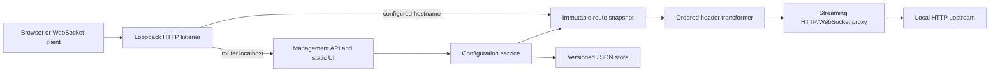
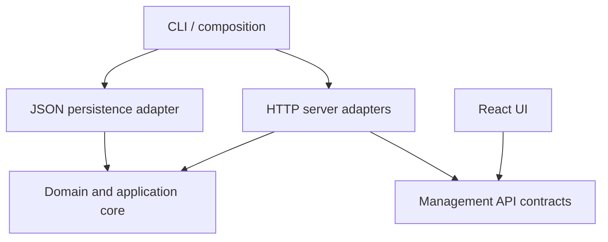
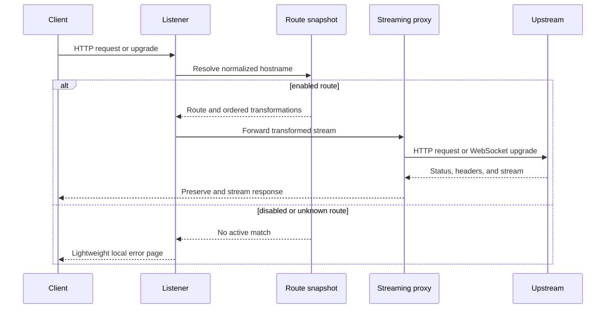

# Architecture

## System Shape

Defftra Router runs as one Node.js process. The same loopback HTTP listener dispatches the reserved management hostname to the API/static UI and configured route hostnames to the streaming proxy.

Vite supplies the React development server and production asset build. It is not present as a second production server.

## Conceptual Components

| Component             | Responsibility                                                                                      |
| --------------------- | --------------------------------------------------------------------------------------------------- |
| CLI                   | Parse startup options, load configuration, handle interactive port fallback, start and stop cleanly |
| Listener              | Bind loopback, normalize Host input, dispatch management/proxy/unknown-host requests                |
| Route snapshot        | Provide immutable, case-insensitive hostname lookup with atomic replacement                         |
| Header transformer    | Apply validated transformations sequentially without domain-specific behavior                       |
| HTTP proxy            | Preserve and stream HTTP traffic, manage timeouts and connection reuse                              |
| WebSocket proxy       | Forward upgrade handshakes and duplex traffic                                                       |
| Management API        | Validate and coordinate configuration reads/writes                                                  |
| Configuration service | Build a validated replacement snapshot and publish it only after persistence succeeds               |
| JSON store            | Load versioned configuration and perform interruption-safe atomic writes                            |
| React UI              | Dashboard, route list, route editor, confirmations, validation, and failure states                  |

## Dependency Direction

Domain types, validation, hostname selection, grouping, and transformations must not depend on Node.js transport, filesystem, CLI, or React code. Server, persistence, CLI, and UI adapters depend inward on those domain contracts. Startup composition wires adapters together.

## Request Flow

## Configuration Publication

Configuration updates must follow this order:

1. Parse and validate an untrusted candidate.
2. Build a complete immutable route snapshot.
3. Write versioned JSON to a sibling temporary file and atomically replace the active file.
4. Atomically replace the in-memory snapshot.
5. Respond with the accepted representation.

A failed validation or write leaves both the active file and active snapshot unchanged.

## Dashboard Grouping

Application groups are projections, not routing entities. Routes group only when their complete normalized upstream target URL strings are equal. Each group exposes every configured route as a distinct one-click launch option. Optional user-defined group names are persisted as a list of target/name records and validated for unique targets.

## Source Layout

The application uses these six top-level boundaries:

| Directory          | Responsibility                                                        |
| ------------------ | --------------------------------------------------------------------- |
| `src/cli/`         | Executable, arguments, prompts, lifecycle, and dependency composition |
| `src/core/`        | Environment-neutral domain and application behavior                   |
| `src/contracts/`   | Environment-neutral management API contracts                          |
| `src/persistence/` | Platform paths and atomic JSON persistence                            |
| `src/server/`      | HTTP management/static adapters, proxying, and WebSocket upgrades     |
| `src/ui/`          | React management UI                                                   |

`src/ui/` is divided into `app/`, `pages/`, `domains/`, and `shared/`. The complete placement and dependency rules are in `.agents/rules/architecture-node-react-full-stack.md`.

Do not create generic top-level `components`, `utils`, `hooks`, `types`, or `shared` dumping grounds. Cross-boundary integration tests live outside `src/`.

## Testing Strategy

- Pure unit tests for validation, normalization, grouping, lookup, and transformations.
- Integration tests with ephemeral servers for HTTP streaming, failure modes, persistence, live publication, and WebSockets.
- React component tests for forms and state behavior.
- Add a focused Playwright suite before V1 release for adding a route, editing transformations, launching a selected flow, and confirming deletion.
- Resource checks should eventually measure idle RAM/CPU and detect leaked connections or timers.

## Implemented Protocol Decisions

- The upstream `Host` header is set from the normalized upstream target after user transformations because correct upstream routing takes precedence.
- An upstream target path prefixes the incoming request path. Target and incoming query parameters are preserved in that order.
- Hop-by-hop HTTP headers are removed and regenerated where required. All other request and response data streams through Node.js without whole-body buffering.
- Redirect status and `Location` are preserved while response caching directives are overridden to prevent browsers from retaining local-development redirects.
- `APPEND` produces ordered logical header values and delegates their wire serialization to Node.js HTTP.
- Vite runs in middleware mode inside the one Node.js process during development. Production serves `dist/ui` directly.
- `pnpm build` creates a portable release directory under `dist/`: one bundled Node.js ESM entry, the compiled UI, and Windows and macOS launchers. Public registry packaging and platform-specific installers remain release work.
